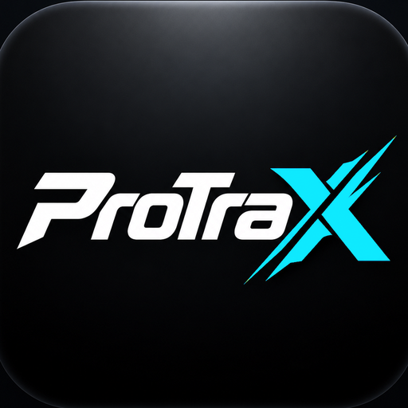

<div align="center">



# ProTraX

**Your workouts. Your progress. Your data.**

A personal workout and body-weight tracker for Android and iPhone. The GitHub Pages version is a local-first Progressive Web App (PWA): no account, server, AI service, or API key is needed.

[Open the ProTraX app](https://ahmedaismail2.github.io/ProTrax-Browser/demo/) · [View the source](https://github.com/AhmedAIsmail2/ProTrax-Browser)

</div>

## Features

- **Plan and follow workouts:** create routines, schedule them by day, and log sets, reps, weights, and timed exercises.
- **Training tools:** rest timers, warm-up sets, supersets, per-exercise rest periods, and optional automatic weight increases for later sets when you change an earlier set.
- **Progress tracking:** workout history, body-weight charts, personal records, estimated one-rep max, activity heatmap, and muscle balance and fatigue views.
- **Exercise library:** search and filter exercises, view demonstrations, save favourites, and add custom exercises.
- **Share your training:** create a workout share card after a session.
- **Bring your data:** import supported workout files and export or restore a JSON backup from Settings.
- **Make it yours:** multiple languages, light and dark modes, and selectable accent colors.
- **Installable on your phone:** add the iPhone PWA from Safari or install it in a supported Android browser. The Android app is also available as a separate native build.

## ProTraX additions

- The app name and logo use the **ProTraX** identity. The larger **X** follows the accent color selected in Settings; blue is the default.
- The browser version exports the backup as a file, so it can be saved outside the browser.
- The workout input flow lets the keyboard’s Done/Enter action dismiss the keyboard from the active field.
- The workout share card is available from the session completion screen.
- Weight changes can cascade to later sets when that option is enabled in workout settings.

## Your data and backups

The GitHub Pages app saves workouts and settings in the browser on your device. Closing the tab does not normally erase that data, but clearing the browser’s site data can remove it. Export a backup regularly from **Settings → Export backup (JSON)** and keep a copy somewhere safe. Use **Import backup** to restore it.

The app does not sync this browser data to an account or cloud service. Exercise images and animations may load from the configured exercise-media host; your workout log stays in local browser storage.

## Install on iPhone

1. Open the [ProTraX app](https://ahmedaismail2.github.io/ProTrax-Browser/demo/) in Safari.
2. Tap **Share**.
3. Choose **Add to Home Screen**.

The installed icon and app name use the ProTraX branding. To preserve your training data when changing devices or browser storage, export a backup first.

## Build the iPhone web app locally

From PowerShell:

```powershell
cd frontend
npm ci
$env:VITE_IPHONE_PWA = "1"
npm run build:iphone
Remove-Item Env:VITE_IPHONE_PWA
```

The PWA output is written to `frontend/dist-iphone/`. GitHub Pages builds and deploys this version from the `main` branch.

## Technology and license

ProTraX uses React, Vite, and Capacitor for its Android app. The project is licensed under **GNU AGPL v3.0**; see [LICENSE](LICENSE) and [NOTICE.md](NOTICE.md) for the full license and notices.
